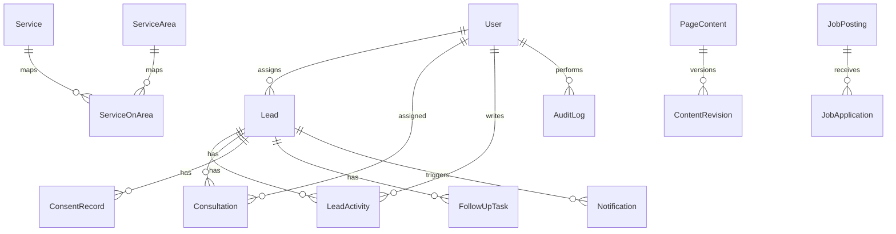

# Prisma schema overview (business admin CRM)

## Core domains

- **Auth:** `User`, `Account`, `Session`, `VerificationToken`, `AdminInvitation`
- **CRM:** `Lead`, `LeadActivity`, `LeadAssignment`, `Consultation`, `FollowUpTask`, `ConsentRecord`
- **CMS:** `PageContent`, `ContentRevision`, `FAQ`, `Testimonial`, `MediaAsset`
- **Services:** `Service`, `ServiceArea`, `ServiceOnArea`
- **Careers:** `JobPosting`, `JobApplication` (resume files in private `storage/resumes/`)
- **Ops:** `SiteSetting`, `Notification`, `AuditLog`

## Indexes & constraints

- UUID primary keys, `createdAt` / `updatedAt` on mutable records
- Lead search indexes on status, service interest, source, createdAt
- Unique: user email, service slug, site setting key, invitation token hash

## Seed policy

`prisma/seed.ts` loads default **site settings**, **published services** from `src/content/careServices.ts`, and **homepage hero** JSON. It does **not** seed fictional leads or testimonials for production.
